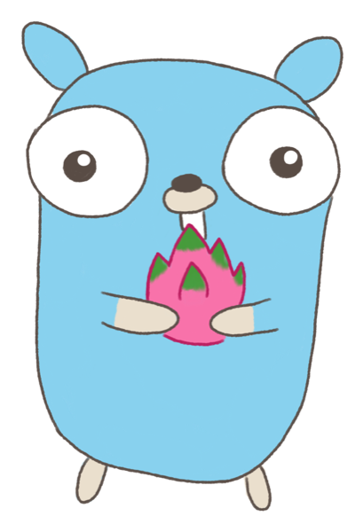

# Pitaya



[](https://github.com/topfreegames/pitaya/actions/workflows/tests.yaml) [](https://coveralls.io/github/topfreegames/pitaya?branch=main) [](https://pkg.go.dev/github.com/topfreegames/pitaya/v3) [](https://pitaya.readthedocs.io/en/latest/?badge=latest) [](LICENSE)

[//]: # (One or two sentences description of the module/service in non technical terms and information about the owner.)

Game server framework for building the real-time backend of multiplayer games, maintained by Wildlife Studios.

> This branch is **Pitaya v3** (module `github.com/topfreegames/pitaya/v3`), currently in beta. The previous major version lives on the [v2 branch](https://github.com/topfreegames/pitaya/tree/v2).

## What does the module do?

[//]: # (A **non technical description** of the main tasks of the module in one or two paragraphs. After reading this section everybody should be able to understand which tasks are performed.)

Pitaya keeps a live connection open with every player, receives their requests, runs the game code that answers them, and pushes messages back to the player whenever something changes on the server.

A game built with Pitaya is usually split into several types of servers, for example one that players connect to and others that run rooms, matches or social features. Pitaya finds those servers, routes each request to the right one, and lets them call each other.

## What problem is solved?

[//]: # (A **non technical** explanation of what problem is solved by this module. This is **not** another description of what the module does, rather why the module exists in the first place.)

Every online game needs the same base before any game feature exists: accept connections, keep track of who is connected, route messages, talk between servers, and report metrics. Writing that base again for each game is slow and error-prone.

Pitaya gives teams that base as a library, so they write only the game's own logic and can grow from a single server to a cluster without rewriting it.

## Recommended Integration Phase: Prototyping

[//]: # (In which phase is this module normally used for the prototyping, alpha, preproduction or production stage of game development.)

Pitaya is the foundation the game's backend code is written on, so it should be adopted at the prototyping phase. A prototype can run as a single server with no external dependencies, and move to cluster mode later without changing its handlers.

## Dependencies

[//]: # (List all the modules or other dependencies that module has, if possible with links to their repositories.)

In standalone mode Pitaya has no external dependencies. In cluster mode it needs:

| Dependency | Used for | Required |
|---|---|---|
| [etcd](https://github.com/etcd-io/etcd) | Service discovery: servers register themselves and find each other | Yes, in cluster mode |
| [NATS](https://github.com/nats-io/nats-server) | Default transport for server-to-server calls and pushes | Yes, unless gRPC is used |
| [gRPC](https://grpc.io/) | Alternative transport for server-to-server calls | No |
| [Prometheus](https://prometheus.io/) / [StatsD](https://github.com/statsd/statsd) | Metrics reporting | No |
| [OpenTelemetry](https://opentelemetry.io/) | Distributed tracing (e.g. Jaeger) | No |
| [Redis](https://redis.io/) | Background workers with reliable RPCs | No |

Players connect through the client SDKs:

- [libpitaya](https://github.com/topfreegames/libpitaya): C client library for iOS, Android, Unity and others.
- [libpitaya-cluster](https://github.com/topfreegames/libpitaya-cluster): lets servers written in C# and C++ join a Pitaya cluster.

## How is the problem solved?

[//]: # (A **more technical description** how the module solved the problem description above. It should not get into too much detail, but provide enough information for a technical leader to understand the implications of using this module.)

Every Pitaya server has a **type** (e.g. `connector`, `room`) and is either a **frontend** or a **backend**:

- **Frontend** servers accept player connections over TCP or WebSocket and hold the player's session.
- **Backend** servers are not reachable by players. They receive work from other servers through RPC.

Game code is organized in **components**. A component registered as a **handler** answers player requests; one registered as a **remote** answers calls from other servers. Requests use the route `serverType.service.method`: when a frontend receives a request for another server type, it forwards it to a server of that type picked through service discovery (randomly by default, or by a custom route function).

Backends can still act on a player: pushes, kicks and session changes travel back to the frontend that owns the connection. Messages are serialized as JSON or Protobuf, and custom serializers can be plugged in.

Most building blocks (service discovery, RPC transport, serializer, metrics reporters, groups, router, packet codec) are interfaces with default implementations, and can be replaced when the server is built.

## Getting Started

### Prerequisites

- [Go](https://go.dev/) >= 1.25.4
- [Docker](https://www.docker.com) with Compose (optional, to run etcd and NATS locally)

### Installing

Add Pitaya to your Go module:

```sh
go get github.com/topfreegames/pitaya/v3
```

To work on Pitaya itself, clone the repository and fetch its submodules:

```sh
git clone https://github.com/topfreegames/pitaya.git
cd pitaya
make setup
```

### Running an example cluster

Start etcd:

```sh
cd examples/testing && docker compose up -d etcd && cd -
```

Run a frontend (connector) and a backend (room) server, each in its own terminal:

```sh
make run-cluster-grpc-example-connector
make run-cluster-grpc-example-room
```

Build [pitaya-cli](./docs/cli.md), the REPL client in this repository, and send a request:

```sh
make build
./build/pitaya-cli
```

```
Pitaya REPL Client
>>> connect localhost:3250
connected!
>>> request room.room.entry
>>> sv->{"code":0,"result":"ok"}
```

More examples live in [examples/demo](./examples/demo):

- [chat](./examples/demo/chat): chat room over WebSocket.
- [cluster](./examples/demo/cluster): frontend and backend servers communicating over NATS.
- [cluster_grpc](./examples/demo/cluster_grpc): the same cluster using gRPC.
- [worker](./examples/demo/worker): background jobs with reliable RPCs.
- [pipeline](./examples/demo/pipeline): handler hooks that run before and after requests.
- [rate_limiting](./examples/demo/rate_limiting): limiting requests per connection.
- [custom_metrics](./examples/demo/custom_metrics): reporting your own metrics.

## Running the tests

```sh
make test          # unit tests
make e2e-test      # end-to-end tests over NATS and gRPC (needs Docker)
```

To load test a Pitaya server, see [xk6-pitaya](./xk6-pitaya).

## Additional information

[//]: # (Here a link to the complete module documentation as well as other additional information should be added as well as contact information.)

- Full documentation: [pitaya.readthedocs.io](https://pitaya.readthedocs.io/en/latest/) (source in the [docs folder](./docs))
- API reference: [pkg.go.dev](https://pkg.go.dev/github.com/topfreegames/pitaya/v3)
- Related projects:
  - [libpitaya](https://github.com/topfreegames/libpitaya)
  - [libpitaya-cluster](https://github.com/topfreegames/libpitaya-cluster)
  - [pitaya-bot](https://github.com/topfreegames/pitaya-bot) (archived)
  - [pitaya-admin](https://github.com/topfreegames/pitaya-admin)
  - [pitaya-protos](https://github.com/topfreegames/pitaya-protos)

### Security

If you have found a security vulnerability, please email security@tfgco.com.

### Acknowledgements

- [nano](https://github.com/lonng/nano) authors, for the framework Pitaya is based on.
- [pomelo](https://github.com/NetEase/pomelo) authors, for the inspiration on the distributed design and protocol.

### License

[MIT License](./LICENSE)
